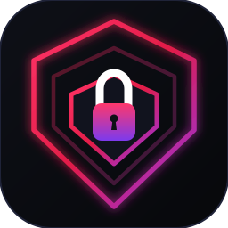

<p align="center">
  
</p>

<h1 align="center">Laravel OmniAuth</h1>

<p align="center">
  <strong>Production-grade authentication package for Laravel web and mobile applications.</strong>
</p>

<p align="center">
  <a href="https://packagist.org/packages/thekaziomar/laravel-omni-auth"></a>
  <a href="https://github.com/kaziomarsh24/laravel-omni-auth/actions"></a>
  <a href="https://packagist.org/packages/thekaziomar/laravel-omni-auth"></a>
  <a href="LICENSE.md"></a>
</p>

---

## Why OmniAuth?

Rolling authentication in Laravel usually starts with Sanctum or Breeze, but production environments serving both web browsers and mobile apps require handling complex attack surfaces:

- **Dual-Mode Delivery**: Transparently negotiates between HttpOnly cookies with CSRF validation for browsers, and Authorization headers with device keychains for mobile.
- **Refresh Token Isolation**: Prevents long-lived refresh tokens from accessing standard API routes via framework guard hooks (`Sanctum::authenticateAccessTokensUsing`).
- **Apple RS256 & Google Token Validation**: Strictly enforces RS256 JWKS asymmetric signatures on Apple identity tokens with key-rotation refetch, and validates Google tokens via tokeninfo.
- **Account Pre-Hijacking Prevention**: Links verified social logins safely; unverified pre-existing passwords and attacker 2FA credentials are automatically purged upon verified social claim.
- **Constant-Time Timing Attack Defense**: Executes dynamic dummy hash comparisons matching the application's active hasher driver on non-existent users.
- **30 Production Endpoints**: Turnkey API surface covering credentials, TOTP 2FA, social login, device auditing, password change, magic links, and GDPR account deletion.
- **Thorough Test Coverage**: 141 automated tests (745 assertions) verifying security, concurrency locks, token rotation, and threat defenses.

---

## Documentation

Full documentation, interactive multi-client integration guides, and API specifications are available at the **[Live Documentation Portal](https://kaziomarsh24.github.io/laravel-omni-auth/)**:

### 🚀 Getting Started
- **[Overview](https://kaziomarsh24.github.io/laravel-omni-auth/getting-started/overview/)** — Architecture principles, threat model, and core features.
- **[Why OmniAuth?](https://kaziomarsh24.github.io/laravel-omni-auth/getting-started/why-omniauth/)** — Comparison matrix vs Breeze, Fortify, and raw Sanctum.
- **[Installation & Setup](https://kaziomarsh24.github.io/laravel-omni-auth/getting-started/installation/)** — Composer installation, migrations, and environment setup.
- **[Configuration Guide](https://kaziomarsh24.github.io/laravel-omni-auth/getting-started/configuration/)** — Exhaustive option-by-option reference for `config/omni-auth.php`.
- **[Customization & Extensibility](https://kaziomarsh24.github.io/laravel-omni-auth/getting-started/customization/)** — `HasOmniAuth` trait, Eloquent relations, Headless mode, custom validation, resource overrides, and events.

### 🛡️ Architecture & Security
- **[Dual-Mode Architecture](https://kaziomarsh24.github.io/laravel-omni-auth/architecture/dual-mode-tokens/)** — Web HttpOnly cookies vs Mobile Bearer token lifecycles and client detection.
- **[Token Rotation & Reuse Detection](https://kaziomarsh24.github.io/laravel-omni-auth/architecture/token-rotation/)** — Single-use refresh token rotation, breach detection, and cascade revocation.
- **[Security Defenses](https://kaziomarsh24.github.io/laravel-omni-auth/architecture/security-defenses/)** — Timing attack protection, cookie security, and multi-tenant isolation.

### ⚡ Features & Workflows
- **[Two-Factor Authentication (2FA)](https://kaziomarsh24.github.io/laravel-omni-auth/features/two-factor-auth/)** — RFC 6238 TOTP, encrypted secrets, emergency recovery codes, and SMS/Email fallback OTP.
- **[Social Login & Native Token Exchange](https://kaziomarsh24.github.io/laravel-omni-auth/features/social-login/)** — OAuth2 redirects and native mobile Google/Apple RS256 JWT exchange.
- **[Multi-Device Management](https://kaziomarsh24.github.io/laravel-omni-auth/features/device-management/)** — Device tracking, IP/User-Agent resolution, single device revocation, and FCM push tokens.
- **[Passwordless Magic Links](https://kaziomarsh24.github.io/laravel-omni-auth/features/magic-links/)** — Signed, single-use, cache-backed magic link authentication.
- **[Email Verification & Account Deletion](https://kaziomarsh24.github.io/laravel-omni-auth/features/verification-and-deletion/)** — Signed email URLs, 6-digit OTP codes, and GDPR-compliant password-verified account deletion.

### 📱 Client Implementation Guides
- **[Next.js Client Guide](https://kaziomarsh24.github.io/laravel-omni-auth/clients/nextjs-web/)** — Next.js 14/15 App Router, Server Components, and HttpOnly cookie proxying.
- **[Flutter Client Guide](https://kaziomarsh24.github.io/laravel-omni-auth/clients/flutter-mobile/)** — `flutter_secure_storage`, Dio interceptors, auto token refresh, and background FCM.
- **[React Native & Expo Client Guide](https://kaziomarsh24.github.io/laravel-omni-auth/clients/react-native-expo/)** — Expo SecureStore, Axios interceptor token chaining, and Apple/Google sign-in.

### 📚 API Reference & Developer Tools
- **[Complete API Reference (30 Endpoints)](https://kaziomarsh24.github.io/laravel-omni-auth/reference/api-reference/)** — Specifications, request schemas, dual-mode payloads, and error codes for all 30 endpoints.
- **[Postman & Bruno Collection (.json)](https://kaziomarsh24.github.io/laravel-omni-auth/laravel-omni-auth.postman_collection.json)** — Pre-configured collection with automated token chaining and embedded documentation.

---

## Requirements

- **PHP**: 8.2, 8.3, 8.4, 8.5, or 8.6
- **Laravel**: 11.x, 12.x, or 13.x
- **Laravel Sanctum**: 4.x

---

## Quickstart

### 1. Install via Composer

```bash
composer require thekaziomar/laravel-omni-auth
```

### 2. Run the Installer

Publishes configuration and database migrations:

```bash
php artisan omni:install
```

### 3. Prepare the User Model

Add the `HasApiTokens` and `HasOmniAuth` traits to your `App\Models\User`:

```php
namespace App\Models;

use Illuminate\Foundation\Auth\User as Authenticatable;
use KaziOmar\OmniAuth\Traits\HasOmniAuth;
use Laravel\Sanctum\HasApiTokens;

class User extends Authenticatable
{
    use HasApiTokens, HasOmniAuth;
}
```

### 4. Schedule Automated Token Pruning

In `routes/console.php`:

```php
use Illuminate\Support\Facades\Schedule;

Schedule::command('omni:prune-tokens --days=30')->daily();
```

---

## API Surface Summary

OmniAuth registers 30 production-ready endpoints under `/api/auth`:

| Module | Endpoints |
| :--- | :--- |
| **Core Auth** | `POST /login`, `POST /register`, `POST /refresh`, `POST /logout`, `GET /me` |
| **Device Sessions** | `GET /devices`, `DELETE /devices/{id}`, `POST /devices/logout-others`, `POST /devices/fcm` |
| **2FA (TOTP)** | `POST /2fa/challenge`, `POST /2fa/fallback-otp`, `POST /2fa/setup`, `POST /2fa/confirm`, `POST /2fa/recovery-codes`, `POST /2fa/disable` |
| **Social Login** | `POST /social/exchange`, `GET /social/{p}/redirect`, `GET\|POST /social/{p}/callback`, `GET /social/accounts`, `DELETE /social/{p}` |
| **Password Lifecycle** | `POST /forgot-password`, `POST /verify-reset-otp`, `POST /reset-password`, `POST /password/change` |
| **Magic Links** | `POST /magic-link`, `GET\|POST /magic-link/verify` |
| **Lifecycle** | `GET\|POST /email/verify/{id}/{hash}`, `POST /email/verify`, `POST /email/resend`, `DELETE /account` |

---

## Testing

Run the test suite with PHPUnit:

```bash
composer test
```

```text
Tests:    141 passed (745 assertions)
```

---

## License

The MIT License (MIT). Please see [License File](LICENSE.md) for more information.
