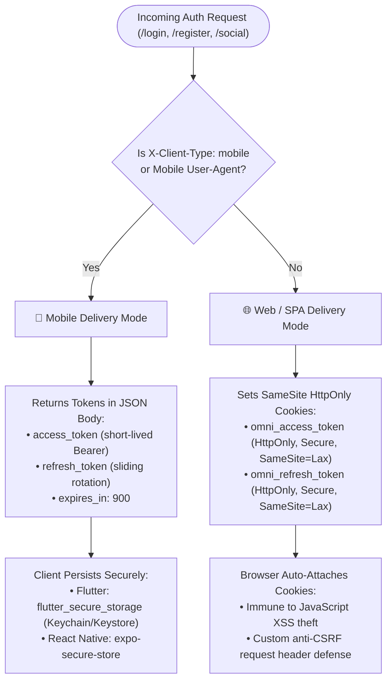

Building modern applications typically requires supporting two distinct client architectures with fundamentally incompatible token storage models:

1. **Web SPAs (Next.js, React, Vue, Svelte)**: Storing tokens in `localStorage` or `sessionStorage` leaves them permanently vulnerable to Cross-Site Scripting (XSS). An attacker who can execute arbitrary JavaScript can exfiltrate stored tokens. Web clients should use encrypted, `HttpOnly`, `SameSite` cookies with CSRF defense.
2. **Mobile Apps (Flutter, iOS Swift, Android Kotlin, React Native)**: Native mobile operating systems do not operate within a browser cookie jar. They possess secure hardware-backed keychains (`Keychain` on iOS, `KeyStore` / `EncryptedSharedPreferences` on Android) and expect standard `Authorization: Bearer <token>` headers.

Laravel OmniAuth bridges this gap by supporting both transport layers from a single set of API endpoints.

---

## Token Delivery Flow

The authentication pipeline automatically determines token delivery semantics using request metadata:



---

## 4-Tier Client Detection Hierarchy

OmniAuth evaluates incoming requests deterministically in the following strict order:

1. **Explicit Header (`X-Client-Type`) — Highest Priority**:
   - `X-Client-Type: mobile` → Delivers tokens directly in JSON body.
   - `X-Client-Type: web` → Sets secure SameSite HttpOnly cookies.
2. **Bearer Authorization Header (`Authorization: Bearer ...`)**:
   - If an authenticated request attaches an `Authorization: Bearer <token>` header and `treat_bearer_as_mobile => true` (default), OmniAuth treats it as an API/Mobile client.
   - *(Note: You can toggle `OMNI_TREAT_BEARER_AS_MOBILE=false` if your web SPA attaches manual Bearer headers but you still want cookie-based clearance on logout).*
3. **User-Agent Runtime Signatures**:
   - If User-Agent contains native mobile runtimes (`Dart`, `Flutter`, `OkHttp`, `Dalvik`, `CFNetwork`, `Alamofire`) or API testing tools (`Postman`, `Insomnia`, `curl`, `httpie`), it is classified as mobile.
4. **Configurable Default Fallback**:
   - When no headers or mobile signatures are detected (standard browsers like Chrome, Safari, Firefox), it falls back to `web` (`OMNI_DEFAULT_CLIENT`, default: `'web'`).

---

## Web Client Implementation Details

When a browser makes a request to `/api/auth/login`:
- OmniAuth sets an `omni_access_token` cookie with `HttpOnly: true`, `SameSite: Lax`, and `Secure: true` (in production).
- The token payload is completely omitted from the JSON body (`access_token` is excluded) to prevent client-side JavaScript from accidentally copying it into `localStorage`.
- A second sliding `omni_refresh_token` cookie is set with configured cookie path (default: `/`).
- **CSRF Isolation**: When authenticating via cookies, state-changing requests (POST, PUT, DELETE) require a custom header (such as `X-Requested-With: XMLHttpRequest`, `X-CSRF-TOKEN`, `X-XSRF-TOKEN`, or `X-Client-Type`). Browsers prohibit cross-origin scripts from forging custom headers, defeating cross-site request forgery without requiring complex session synchronization.

---

## Mobile Client Implementation Details

When a mobile app makes a request:
- The app passes `X-Client-Type: mobile` (or a native User-Agent).
- OmniAuth omits Set-Cookie headers.
- The JSON response contains:

```json
{
  "ok": true,
  "message": "Authenticated successfully.",
  "data": {
    "user": {
      "id": 42,
      "name": "Jane Developer",
      "email": "jane@example.com"
    },
    "tokens": {
      "access_token": "1|qX8y...",
      "refresh_token": "2|mK9z...",
      "token_type": "Bearer",
      "expires_in": 900
    }
  }
}
```

- Mobile clients store the `access_token` and `refresh_token` in secure device storage (e.g., `flutter_secure_storage` or Android KeyStore).
- On subsequent requests, the app attaches:

```http
Authorization: Bearer 1|qX8y...
```

---

## Comparison Matrix

| Property | Web SPA Mode | Mobile Client Mode |
| :--- | :--- | :--- |
| **Header** | Default (or `X-Client-Type: web`) | `X-Client-Type: mobile` |
| **Token Delivery** | `Set-Cookie` (`HttpOnly`, `SameSite`) | JSON Body (`data.tokens`) |
| **Storage Target** | Browser Cookie Jar | Keychain / EncryptedSharedPreferences |
| **XSS Vulnerability** | Immune (JavaScript cannot read cookie) | Immune (Native sandbox isolation) |
| **CSRF Defense** | SameSite + Custom Header requirement | Native apps are exempt from browser CSRF |
| **Token Lifespans** | 15 min access / 30 day refresh | 15 min access / 30 day refresh |
