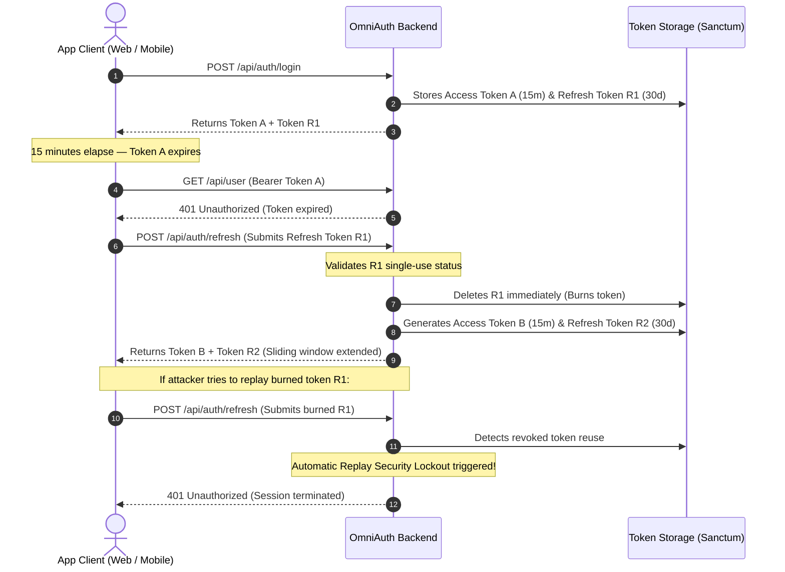

To maintain high security without forcing users to re-enter passwords daily, OmniAuth implements sliding token rotation paired with device session tracking.

---

## Token Rotation Mechanics

When a client receives tokens, two distinct token records are generated in Laravel Sanctum:

1. **Access Token**: Short-lived (default 15 minutes) with full API abilities `['access-api']`.
2. **Refresh Token**: Long-lived (default 30 days) with restricted ability `['refresh']`.



### Single-Use Refresh Tokens
Refresh tokens are strictly single-use. When [`POST /api/auth/refresh`](/laravel-omni-auth/reference/api-reference/#post-apiauthrefresh) is called:
- OmniAuth validates the provided refresh token.
- The existing refresh token is immediately deleted from the database.
- A new access token and a new sliding refresh token are generated.
- If a revoked refresh token is presented again, the request fails with HTTP 401.

---

## Device Session Linkage

Every authenticated session is tracked in the `auth_devices` database table:

| Column | Description |
| :--- | :--- |
| `id` | Unique primary key for the device session |
| `user_id` | Foreign key referencing the authenticated user |
| `device_id` | Unique client-provided hardware or installation UUID |
| `platform` | Operating system (`ios`, `android`, `web`, `windows`, `macos`) |
| `device_name` | Human-readable label (e.g., "iPhone 15 Pro", "Chrome on macOS") |
| `browser` | Detected browser engine or app bundle |
| `ip_address` | Client IP address at time of authentication |
| `fcm_token` | Optional Firebase Cloud Messaging push token (see [Universal Push Tokens](/laravel-omni-auth/features/device-management/#4-update-push-notification-token-fcm--apns--expo)) |
| `refresh_token_id` | Foreign key linking this device to its active refresh token |
| `last_active_at` | Timestamp of the most recent API activity |

### Device Revocation

When a user views their active sessions via [`GET /api/auth/devices`](/laravel-omni-auth/reference/api-reference/#get-apiauthdevices), they can revoke any device by ID ([`DELETE /api/auth/devices/{id}`](/laravel-omni-auth/reference/api-reference/#delete-apiauthdevicesid)):

```php
// Inside DeviceManager::revoke()
$device = AuthDevice::where('user_id', $user->id)->findOrFail($deviceId);

// Delete the bound refresh token immediately
if ($device->refresh_token_id) {
    PersonalAccessToken::where('id', $device->refresh_token_id)->delete();
}

// Delete all personal access tokens associated with this device
// ...
$device->delete();
```

Because the refresh token record is deleted in the database, any future attempt by that device to refresh its session receives an immediate HTTP 401 error, terminating the compromised session.

---

## Automated Pruning Command

To prevent database bloat from expired Sanctum tokens and abandoned device records, OmniAuth provides the `omni:prune-tokens` Artisan command:

```bash
php artisan omni:prune-tokens --hours=24
```

This command executes two cleanup tasks:
1. Deletes all `personal_access_tokens` whose `expires_at` timestamp is beyond the specified hours (default: 24 hours).
2. Deletes all stale `auth_devices` records older than 90 days with no active tokens.
