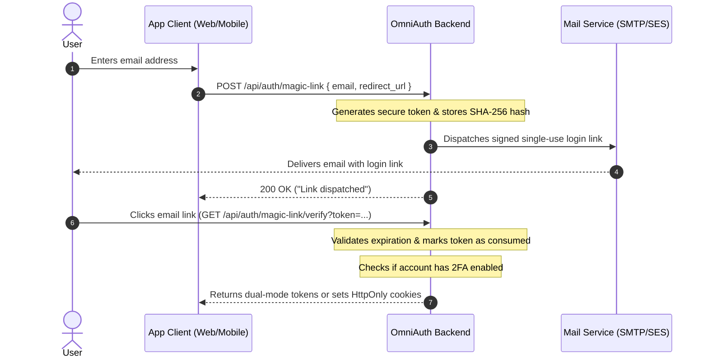

Passwordless login eliminates passwords entirely by emailing the user a cryptographically secure, single-use authentication link.

---

## Workflow Diagram



---

## Endpoints

### 1. Request a Magic Link

Generates a single-use token and dispatches an email containing the signed login link (see [`POST /api/auth/magic-link`](/laravel-omni-auth/reference/api-reference/#post-apiauthmagic-link)):

```http
POST /api/auth/magic-link
Content-Type: application/json

{
  "email": "jane@example.com",
  "redirect_url": "https://app.example.com/auth/callback"
}
```

Response:
```json
{
  "ok": true,
  "message": "If an account exists with this email, a login link has been dispatched."
}
```

#### Open Redirect Protection on `redirect_url`
The `redirect_url` parameter is strictly validated against `config('app.url')` and whitelisted domains. Any URL containing `@`, `\`, or unauthorized hosts is rejected with HTTP 422.

:::caution[Localhost Redirects Blocked in Production]
When `APP_ENV=production`, OmniAuth automatically blocks `http://localhost` and private IP addresses in `redirect_url` to defend against phishing and open-redirect vulnerabilities.

In local development (`APP_ENV=local`), localhost URLs like `http://localhost:3000/auth/callback` are permitted. When deploying to staging or production, ensure your frontend client supplies a production origin that matches your whitelist in `config/omni-auth.php`.
:::

---

### 2. Verify Magic Link

When the user clicks the link in their email (see [`GET|POST /api/auth/magic-link/verify`](/laravel-omni-auth/reference/api-reference/#getpost-apiauthmagic-linkverify)):

```http
GET /api/auth/magic-link/verify?token=9f8e7d6c5b4a3...
Accept: application/json
```

Or via POST with custom client headers:

```http
POST /api/auth/magic-link/verify
Content-Type: application/json
X-Client-Type: mobile

{
  "token": "9f8e7d6c5b4a3..."
}
```

Response (Standard Account):
```json
{
  "ok": true,
  "message": "Logged in successfully via magic link.",
  "data": {
    "user": {
      "id": 1,
      "email": "jane@example.com"
    },
    "tokens": {
      "access_token": "5|c8b1...",
      "refresh_token": "6|d9a2...",
      "token_type": "Bearer"
    }
  }
}
```

Response (If Account Has 2FA Enabled):
```json
{
  "ok": true,
  "message": "Two-factor authentication required.",
  "data": {
    "requires_2fa": true,
    "two_factor_token": "2fa_challenge_tok..."
  }
}
```

Even when logging in via magic link, users with 2FA enabled must resolve the challenge token via [`POST /api/auth/2fa/challenge`](/laravel-omni-auth/reference/api-reference/#post-apiauth2fachallenge) with a valid TOTP code before access tokens or session cookies are issued.
