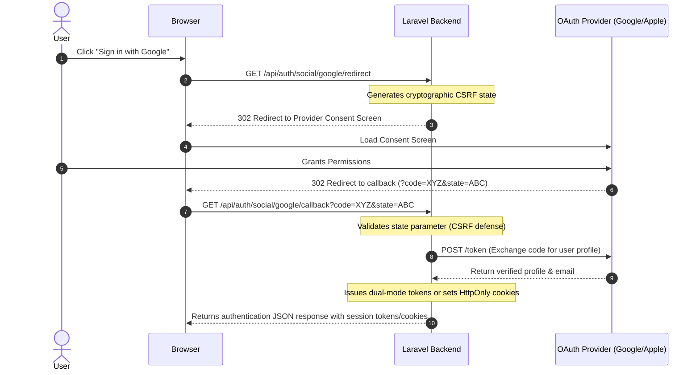

Modern multi-platform apps need two distinct social login strategies:
1. **Web Browsers**: Standard OAuth 2.0 redirect flows with CSRF state verification.
2. **Mobile Apps**: Native SDK sign-in (e.g., `google_sign_in` or `sign_in_with_apple` in Flutter/React Native) that yields an `id_token` directly on the device, requiring backend verification without redirect hops.

OmniAuth handles both flows out of the box.

---

## Web OAuth 2.0 Flow

Supported providers: `google`, `apple`, `github`. Initiated via [`GET /api/auth/social/{provider}/redirect`](/laravel-omni-auth/reference/api-reference/#get-apiauthsocialproviderredirect) and completed at [`GET|POST /api/auth/social/{provider}/callback`](/laravel-omni-auth/reference/api-reference/#getpost-apiauthsocialprovidercallback).



### Strict State Parameter Enforcement
OmniAuth enforces CSRF state parameter validation on all OAuth callbacks. If an incoming callback lacks a `state` parameter or provides an unrecognized token, OmniAuth aborts with HTTP 400.

---

## Native Mobile Token Exchange

Native mobile apps should never open an external browser window for OAuth redirects if a native biometric or system prompt is available.

Using the mobile SDK, the native app retrieves a cryptographically signed identity token (`id_token`) directly from Google or Apple, then submits it to the exchange endpoint ([`POST /api/auth/social/exchange`](/laravel-omni-auth/reference/api-reference/#post-apiauthsocialexchange)):

```http
POST /api/auth/social/exchange
X-Client-Type: mobile
Content-Type: application/json

{
  "provider": "apple",
  "id_token": "eyJhbGciOiJSUzI1NiIsImtpZCI6..."
}
```

Response:
```json
{
  "ok": true,
  "data": {
    "user": {
      "id": 15,
      "name": "Jane Doe",
      "email": "jane@privaterelay.appleid.com"
    },
    "tokens": {
      "access_token": "3|a8c9...",
      "refresh_token": "4|b7d2...",
      "token_type": "Bearer",
      "expires_in": 900
    }
  }
}
```

### Provider Token Verification Mechanics

- **Apple Sign-In (`apple`)**: Identity tokens are validated using native OpenSSL RS256 cryptographic verification against Apple's live public keys (`https://appleid.apple.com/auth/keys`). JWKS keys are cached with 12-hour TTL and automatically refetched when key rotation introduces a new `kid`. Token payload verification enforces matching audience (`aud`), issuer (`https://appleid.apple.com`), and valid non-expired timestamps.
- **Google Sign-In (`google`)**: Identity tokens are verified against Google's tokeninfo endpoint (`https://oauth2.googleapis.com/tokeninfo`), ensuring the token's audience matches the configured mobile or web client IDs and that the user's email is verified by Google.

---

## Connected Account Management

Authenticated users can inspect and manage their linked social providers:

### 1. List Connected Accounts
```http
GET /api/auth/social/accounts
Authorization: Bearer <access_token>
```

Response:
```json
{
  "ok": true,
  "data": {
    "accounts": [
      {
        "id": 1,
        "provider": "google",
        "provider_id": "google-sub-12345",
        "created_at": "2026-11-04T12:00:00Z"
      }
    ]
  }
}
```

### 2. Unlink a Social Account
```http
DELETE /api/auth/social/google
Authorization: Bearer <access_token>
```

Response:
```json
{
  "ok": true,
  "message": "Successfully unlinked google account."
}
```

---

## Apple Sign-In Cryptographic Verification

:::tip[Apple Web Services ID vs iOS App Bundle ID]
Apple generates identity tokens with different audience (`aud`) values depending on the client platform:
- **Web Browser OAuth:** The audience is your Apple **Services ID** (e.g. `com.company.web`).
- **Native iOS / Flutter App:** The audience is your Apple **App Bundle ID** (e.g. `com.company.app`).

In `config/omni-auth.php`, configure your Apple client settings accordingly, or set your iOS Bundle ID so that tokens exchanged via [`POST /api/auth/social/exchange`](/laravel-omni-auth/reference/api-reference/#post-apiauthsocialexchange) pass cryptographic audience verification without triggering `400 Invalid Token Audience`.
:::

When verifying Apple identity tokens:
1. **Header Inspection**: Decodes the JWT header and verifies that `alg` is strictly `RS256`. Tokens specifying `HS256` or `none` are immediately rejected.
2. **JWKS Fetching**: Apple's JSON Web Key Set (`https://appleid.apple.com/auth/keys`) is retrieved. If the request fails, the cache is bypassed to avoid locking users out.
3. **Public Key Derivation**: The matching RSA key (`kid`) is assembled from its modulus (`n`) and exponent (`e`) into a standard PKCS#8 / PKIX PEM format.
4. **Signature Validation**: The token signature is validated against the reconstituted public key using OpenSSL (`OPENSSL_ALGO_SHA256`).
5. **Audience & Expiration**: Confirms that `aud` matches your configured Apple Client ID (or iOS App Bundle ID) and that `exp` is in the future.

---

## Google Sign-In Verification

When verifying Google identity tokens:
1. Queries Google's public tokeninfo endpoint or certificates.
2. Validates that the token's audience (`aud`) matches your configured web `client_id` or any entry in `mobile_client_ids`.
3. Verifies that the issuer is either `accounts.google.com` or `https://accounts.google.com`.
4. Confirms that `email_verified` is true.

---

## Account Pre-Hijacking Mitigation

If a user signs in via a social provider with an email that already exists in the database:
- **If the existing account was already email-verified**: The social identity is linked to the existing user record, preserving account history.
- **If the existing account was unverified (registered with a password)**: OmniAuth assumes the pre-existing password may have been registered by an attacker. OmniAuth links the verified social provider, purges the existing password with high-entropy cryptographic bytes, revokes all existing tokens, and flushes active sessions.
