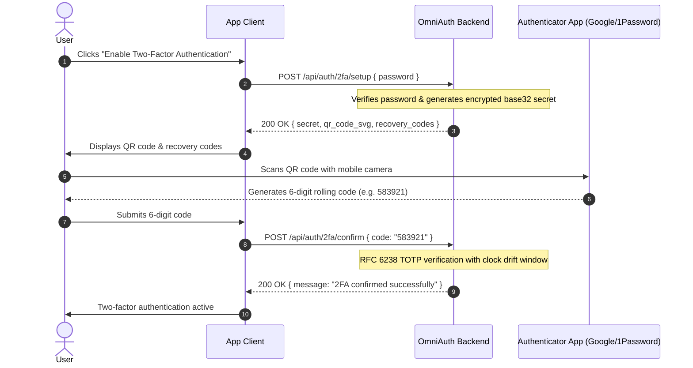

OmniAuth includes full-featured Two-Factor Authentication (2FA) compatible with standard authenticator applications (Google Authenticator, Apple Passwords, 1Password, Authy).

---

## Architecture & Storage Security

- **Encrypted Secrets**: TOTP secrets are encrypted at rest using Laravel's application key via `Crypt::encryptString()`. If the database is compromised, secrets cannot be read without the application master key.
- **Hashed Recovery Codes**: Backup recovery codes are securely hashed using Laravel's configured hasher (`Hash::make`, Bcrypt/Argon2id) before database persistence. Plaintext recovery codes are only displayed once to the user during setup.
- **Challenge Isolation**: During initial login, if 2FA is active, access tokens are withheld. The client receives a restricted `2fa-challenge` token valid only for calling the verify endpoint.

:::warning[Server NTP Clock Synchronization]
TOTP verification strictly implements **RFC 6238** (30-second time-based windows). Although OmniAuth permits a standard 1-step clock drift allowance (±30 seconds), if your Docker container, local VM, or cloud server's system clock deviates from atomic time by more than 60 seconds, valid Google Authenticator codes will be rejected.

Ensure your host or server environment has active **NTP (Network Time Protocol)** synchronization (`systemd-timesyncd`, `chrony`, or `ntp`).
:::

---

## Activation Flow



### 1. Initiate Setup

The user must provide their current password to begin setup (see [`POST /api/auth/2fa/setup`](/laravel-omni-auth/reference/api-reference/#post-apiauth2fasetup)):

```http
POST /api/auth/2fa/setup
Authorization: Bearer <access_token>
Content-Type: application/json

{
  "password": "UserCurrentPassword123!"
}
```

Response:
```json
{
  "ok": true,
  "message": "Two-factor setup initiated. Confirm with a valid code from your authenticator app to enable.",
  "data": {
    "secret": "JBSWY3DPEHPK3PXP",
    "qr_code_url": "otpauth://totp/MyApp:jane@example.com?secret=JBSWY3DPEHPK3PXP&issuer=MyApp",
    "svg_qr": "<svg ...></svg>",
    "recovery_codes": [
      "A1B2-C3D4",
      "E5F6-G7H8",
      "I9J0-K1L2"
    ]
  }
}
```

### 2. Confirm Setup

The user enters the 6-digit code shown in their authenticator app to verify that setup was successful (see [`POST /api/auth/2fa/confirm`](/laravel-omni-auth/reference/api-reference/#post-apiauth2faconfirm)):

```http
POST /api/auth/2fa/confirm
Authorization: Bearer <access_token>
Content-Type: application/json

{
  "code": "482910"
}
```

Response:
```json
{
  "ok": true,
  "message": "Two-factor authentication has been confirmed and enabled."
}
```

---

## Login Authentication Challenge

When a user with 2FA enabled logs in via credentials, social exchange, or magic link, OmniAuth returns a challenge response:

```json
{
  "ok": true,
  "message": "Two-factor authentication is required.",
  "data": {
    "requires_2fa": true,
    "two_factor_token": "2fa_challenge_9a8b7c6d...",
    "expires_in": 300
  }
}
```

The client then prompts the user for their 6-digit code and calls the challenge resolution endpoint [`POST /api/auth/2fa/challenge`](/laravel-omni-auth/reference/api-reference/#post-apiauth2fachallenge) (accepts `two_factor_token` or `challenge_token`):

```http
POST /api/auth/2fa/challenge
Content-Type: application/json

{
  "two_factor_token": "2fa_challenge_9a8b7c6d...",
  "code": "482910"
}
```

Once validated:
- The challenge token is destroyed.
- Real `access_token` and `refresh_token` instances are issued.
- The standard Laravel `Illuminate\Auth\Events\Login` event is fired.

### Recovery Code & Fallback OTP

If the user loses access to their authenticator app:
1. **Recovery Codes**: They can pass any of their unused 8-character recovery codes in the `code` field. OmniAuth hashes the code, verifies the match, and burns that specific recovery code so it cannot be reused.
2. **Emergency Fallback OTP**: If recovery codes are also unavailable, the client can call [`POST /api/auth/2fa/fallback-otp`](/laravel-omni-auth/reference/api-reference/#post-apiauth2fafallback-otp) with their `two_factor_token`. OmniAuth dispatches the `TwoFactorFallbackOtpRequested` event to send an emergency 6-digit OTP code to the user's verified email, SMS, or WhatsApp.

:::tip[Multi-Channel OTP Delivery (SMS / WhatsApp)]
To route emergency 2FA fallback OTPs directly to user phones via Twilio SMS or Meta WhatsApp Business, see our [Multi-Channel Delivery Recipes](/laravel-omni-auth/getting-started/customization/#multi-channel-delivery-recipes).
:::

---

## Management Endpoints

### Regenerating Recovery Codes
Requires password confirmation. Returns eight fresh codes and invalidates all prior recovery codes (see [`POST /api/auth/2fa/recovery-codes`](/laravel-omni-auth/reference/api-reference/#post-apiauth2farecovery-codes)):

```http
POST /api/auth/2fa/recovery-codes
Authorization: Bearer <access_token>
Content-Type: application/json

{
  "password": "UserCurrentPassword123!"
}
```

### Disabling 2FA
Requires password confirmation. Wipes the TOTP secret and recovery codes (see [`POST /api/auth/2fa/disable`](/laravel-omni-auth/reference/api-reference/#post-apiauth2fadisable)):

```http
POST /api/auth/2fa/disable
Authorization: Bearer <access_token>
Content-Type: application/json

{
  "password": "UserCurrentPassword123!"
}
```
