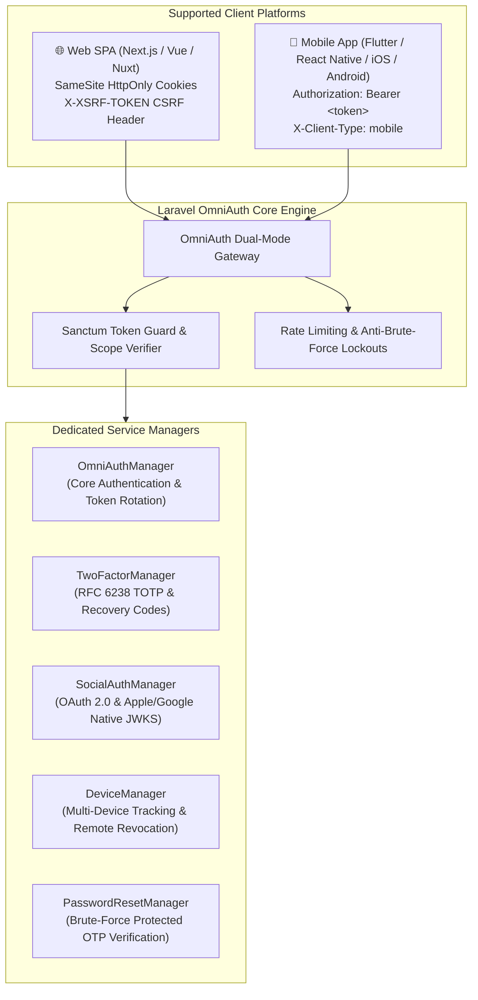

Laravel OmniAuth is a comprehensive, production-grade authentication package designed for engineering teams running Laravel as an API backend serving both web single-page applications (SPAs) and native mobile applications (iOS and Android).

While Laravel provides fundamental primitives such as Sanctum and Socialite, assembling them into a hardened, production-ready system requires hundreds of lines of boilerplate and careful security auditing. Most engineering teams repeatedly solve the same challenges: dual client token semantics, device revocation, two-factor authentication, social token exchange, and account lifecycle management.

OmniAuth provides a unified, battle-tested API surface consisting of 29 production-ready endpoints and an extensible service architecture.

## Supported Environments

- **PHP**: 8.2, 8.3, 8.4, 8.5, 8.6
- **Laravel**: 11.x, 12.x, 13.x
- **Databases**: MySQL 8.0+, PostgreSQL 13+, SQLite 3.35+
- **Cache Drivers**: Redis, Memcached, Database, Array (testing)

## Functional Domains

The package organizes authentication responsibilities into seven distinct, decoupled modules:

### 1. Core Authentication
Handles registration, credential-based login, token renewal, session termination, and profile retrieval. It supports dual-mode delivery: SameSite HttpOnly cookies for web browsers and short-lived Bearer tokens for mobile clients.

### 2. Device Management
Every authenticated session is anchored to a tracked device record storing IP address, platform (iOS, Android, Web, Desktop), browser or app version, and optional push notification tokens (FCM/APNS). Users can list active sessions and revoke compromised devices.

### 3. Two-Factor Authentication (TOTP)
RFC 6238 compliant time-based one-time passwords. Secrets are encrypted at rest with Laravel's application key. Recovery codes are cryptographically hashed using SHA-256. Setup and recovery code regeneration require password re-authentication.

### 4. Social Authentication
Unified social login covering standard OAuth 2.0 browser redirect flows and native mobile ID token exchange (Google and Apple). Includes cryptographic RS256 signature verification via Apple JWKS with safe cache fallback.

### 5. Password Management
Secure password reset flows via signed URL or 6-digit OTP codes. Open-redirect protected redirect validation rejects host-spoofing techniques.

### 6. Passwordless Magic Links
Cryptographically signed, single-use authentication links sent via email. Enforces expiration and client-type isolation.

### 7. Verification and Account Lifecycle
Signed email verification flows, self-service account deletion with cascading credential cleanup, and unverified account purge capabilities.

## Architecture at a Glance

The following diagram illustrates how OmniAuth handles requests across different client platforms:

